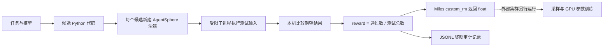

# Miles RL：AgentSphere 沙箱执行与奖励闭环

本场景演示 RL 中的可验证奖励：模型提交一份 Python 程序，AgentSphere 为每个候选提供独立执行环境，本机评分后把 float reward 返回 Miles。无需在沙箱中安装训练框架或配备 GPU。



页面地址：`http://127.0.0.1:8766/#scenario/miles_rl`，也可在“客户场景”选择 **Miles RL · 沙箱执行与奖励闭环**。

## 演示前准备

先在“环境配置”完成账号与 Gateway 连接检查。RL 场景填写可用的 Ready `Template ID:Build ID`，或留空使用全局已有 Ready 模板；不会现场创建或构建模板。镜像需 Linux、Python 3、标准库 resource，以及可写 `/tmp` 的现有用户，默认 `sandbox`。本工具不自动创建镜像用户。

候选来源有两种：

- **实时模型生成**：在本场景填写 OpenAI 兼容 Base URL、模型 ID、API Key，模型从本机调用；模型 Key 不进入沙箱。填写的是模型提供商密钥，不是 AgentSphere API Key。
- **内置正负对照**：不调用模型。选择“把所有数相加”等错误代码与正确代码作对比，现场在真实沙箱执行后评分；不把它们称为模型 rollout 或学习结果。

可配置 2–4 个候选和每个测试 1–10 秒子进程时限。每个候选使用独立沙箱；同一候选内各测试使用独立子进程及临时工作目录。创建的沙箱受全局 timeout 限制，请及时清理。

## 六步演示

| 步骤 | 实际动作 | 现场可见结果 |
|---|---|---|
| 准备环境 | SDK 查询 Ready Build、新建专用环境检查沙箱、以指定用户执行 Python 和 id | Template/Build、Sandbox ID、Python 与 UID |
| 生成候选 | 本机调用模型 `/chat/completions`，或选择内置对照源码 | 候选来源、模型调用次数、源码与 SHA256 |
| 执行并评分 | SDK 为每个候选创建沙箱、上传源码及 launcher、执行 6 个输入；本机计算通过率 | 逐测试 stdout/退出码、通过数、reward、独立实例 ID |
| Miles 奖励回调 | 实际调用同一 async reward hook；新建沙箱重测首个候选并核对 reward | float 返回值与前次一致；sample.reward 保持 None |
| 导出 | 导出本轮源码、哈希、Sandbox ID、通过数与 reward | 可下载 `miles-rewards.jsonl`、接入 hook 路径 |
| 释放资源 | 仅删除本轮登记的环境检查、候选与回调沙箱，删除后查询 | 404；保留外部 Ready 模板及其他场景资源 |

任务 `sum_even_v1`：stdin 读取 `{"values":[整数]}`，stdout 输出 `{"result":偶数之和}`，包含负偶数、零和空列表。期望值在本机计算，只有测试输入传入沙箱。内置前两个候选分别通过 3/6 与 6/6，现场应得到 0.5 和 1.0。组内中心化信号仅展示 `reward - 平均reward`，未实现 GRPO loss 或梯度更新。

RL 步骤有明确依赖，需先执行准备、生成、评分。“仅准备状态”不会隐式调用模型或伪造候选/奖励；缺前置结果会提示。换用户、时限、模板或开始新一轮时先清理，避免不同轮次的证据混合。

## Miles 接入方式

接口依据 RadixArk Miles commit **2f627e0887f26a5a39a749e2d71b5b3c7c9db003** 的 [customization 文档](https://github.com/radixark/miles/blob/2f627e0887f26a5a39a749e2d71b5b3c7c9db003/docs/user-guide/customization.md) 与 [rm_hub 实现](https://github.com/radixark/miles/blob/2f627e0887f26a5a39a749e2d71b5b3c7c9db003/miles/rollout/rm_hub/__init__.py) 核对。未来 Miles 升级需重新检查合约。

在已配置好的 Linux Miles worker 环境安装本项目锁定的 SDK 依赖，并把项目目录加入每个 worker 的 Python 搜索路径。华为 SDK 保持 `e2b==2.42.0`、`e2b-code-interpreter==2.9.1`、官方文档指定 `agentsphere-e2b-patch==0.2.0`，不能随意升级已有 Miles 集群依赖。先在隔离环境检查依赖兼容性；本项目不负责部署 Miles/SGLang/训练框架。

```bash
# 在每个执行 reward 的 worker 中设置；值从客户自己的安全配置注入
export PYTHONPATH="/path/to/agentsphere-demo-studio${PYTHONPATH:+:$PYTHONPATH}"
export E2B_API_URL="https://agentsandbox.cn-southwest-2.myhuaweicloud.com"
export E2B_SANDBOX_URL="https://YOUR_GATEWAY_DOMAIN"
export AGENTSPHERE_RL_TEMPLATE_REF="YOUR_TEMPLATE_ID:YOUR_BUILD_ID"
export AGENTSPHERE_RL_USER="sandbox"
export AGENTSPHERE_RL_CASE_TIMEOUT="3"
export AGENTSPHERE_RL_CONCURRENCY="2"
# E2B_API_KEY 从安全配置注入，不在源码或训练命令行内写真实值
```

在已有 Miles 训练配置追加：

```text
--custom-rm-path studio.scenarios.miles_rl.reward.reward
```

这是逐 sample 的 custom_rm，**不要开启 group reward 模式**。本适配器返回单个 float，不接收整个 sample group。Miles 生成的 `sample.response` 应是候选 Python 源码；数据加载/rollout 必须保留 `sample.metadata["agentsphere_task_id"] = "sum_even_v1"`。缺任务标识会在创建云资源前失败，避免把别的任务误评分。本案例不提供通用任务数据集转换器。

```python
# Miles 使用的真实入口；不需要在训练脚本内手动赋 sample.reward
async def reward(args, sample, **kwargs) -> float:
    ...  # studio/scenarios/miles_rl/reward.py：新建沙箱、执行、评分、清理
```

hook 写入小体积 `sample.metadata.agentsphere_reward_evidence` 后返回 float；由 Miles `batched_async_rm` 按上游逻辑设置 `sample.reward`。外部环境调用始终清理 episode 沙箱。清理失败会携带 Sandbox ID 报错，需要人工核对回收。

`AGENTSPHERE_RL_CONCURRENCY` 是**单 worker 进程**的上限（1–8），并非集群总限流。多个进程/节点需要在外部按账号沙箱配额限制并发。传入模型 Key 不是 reward hook 的需要项，hook 仅执行 Miles 已生成的 response。

独立验证入口：

```bash
# 不安装 Miles：验证同一个 hook 合约与真实 AgentSphere 执行
python examples/miles_reward_smoke.py
# 已安装上述版本 Miles 的 worker：经实际 async_rm 载入 hook
python examples/miles_reward_smoke.py --with-miles
```

默认使用本项目自带的正确对照代码，也可 `--source /path/to/candidate.py`；候选只在云端执行，不会在本机运行。每次调用创建并删除独立沙箱。

## 评分与执行边界

- 错误答案、候选异常、输出格式不符、候选超时及语法错误属于候选失败，产生低 reward。网关、SDK、沙箱创建、文件上传、trusted launcher 异常则中止并报基础设施错误，不把平台故障计作模型零分。
- launcher 限制 CPU 时间、地址空间、输出文件大小、打开文件数与进程数，清理同一进程组子进程；模型 Key 不写入候选环境。进程资源限制不等于完整的恶意代码防护，生产 RL 还需专用账号、网络出站策略、只读数据、并发配额及持续隔离审计。每个候选的新沙箱是本演示的主要执行隔离边界。
- 固定 6 个测试适合讲解可验证奖励，未覆盖所有程序语义；测试集与 oracle 可在独立任务版本中扩展。
- 页面“回调验证”调用与 Miles 集群相同的 Python hook，使用 sample 合约对象；未连接训练集群。`--with-miles` 才经 Miles 实际调度模块，需客户已安装该框架。
- 导出的 JSONL 是奖励审计证据，不包含训练所需的 token/logprob/策略权重信息，不能当作 checkpoint、完整训练输入或模型能力提升证明。

## 已验证范围

2026-11-11 在用户自有贵阳一区域账号，使用锁定 SDK 与官方 patch 完成真实沙箱测试：非 root 用户 `sandbox`（uid=2001）、Python 3.12.10；内置错误/正确候选得到 0.5/1.0，hook 独立沙箱复测返回 0.5，JSONL 导出通过，创建的 4 个沙箱均已清理。记录未预置到客户页面，也不包含在发布 ZIP 中。GPU 训练与完整 Miles 集群尚未运行。

独立 smoke 脚本（直接 hook 合约模式）也通过环境变量配置完成真实云端执行，正确候选 6/6、reward=1.0，episode 沙箱已删除并查询 404。`--with-miles` 路径提供给已有 Miles worker，未在本机运行。

同日尝试本机已有模型配置，模型接口返回 HTTP 402，生成步骤明确失败，没有静默切换内置代码或产生 reward；此轮仅创建的环境检查沙箱也已清理。实时生成的请求结构通过本地 mock 验证，但真实模型生成尚未通过。更换可用模型配置后需重新执行本轮验证。
